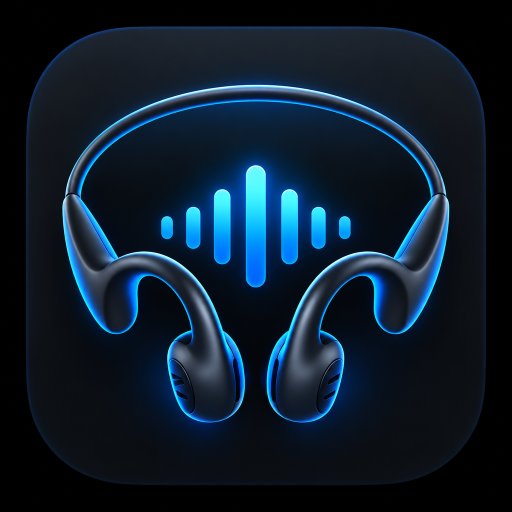

# Sanag Control — B21S for iOS



[](https://github.com/LucaXTech/sanag-b21s-control-ios/actions/workflows/ios-build.yml)


**An independent, unofficial iOS controller for Sanag B21S headphones.**

Sanag Control uses **CoreBluetooth** to read and select the six firmware EQ presets, and can attempt to restore the last selected preset when the headphones reconnect. It also exposes a **Shortcuts App Intent** that can be run from an iOS Bluetooth connection automation without opening the full interface.

**Author:** Luca Serioli ([@LucaXTech](https://github.com/LucaXTech))  
**Current released version:** 0.4.4 — pre-release / hardware validation in progress

**In development:** 0.4.5, optional opt-in compatibility reporting (requires a configured HTTPS receiver before release).

## Features

- Six firmware EQ presets: **Stereo+**, **Pop**, **Rock**, **Classica**, **Voci**, **Soft** (BLE indices `0…5`).
- Detect, reconnect to and remember the B21S BLE peripheral.
- Optionally restore the saved EQ preset on reconnection.
- Shortcuts action: **Ripristina EQ B21S**, suitable for a Bluetooth connection automation.
- Experimental battery level reading from the B21S BLE protocol, independently of iOS battery widgets.
- Minimal SwiftUI home, Settings, read-only BLE protocol reference and local diagnostic events.
- Background CoreBluetooth mode and state restoration; **iOS decides if and when background execution is granted**.

## Requirements

- **Xcode 26+** with iOS SDK; a Mac for signing and installation.
- **iOS 17+**, an iPhone and Sanag B21S headphones for hardware testing.
- An Apple Account (Personal Team can be used for local development).

## Build and install

1. Clone the repository and open **`SanagControl.xcodeproj`** in Xcode.
2. Select the **SanagControl** target → **Signing & Capabilities** → enable **Automatically manage signing** and choose your own Team.
3. **Change `PRODUCT_BUNDLE_IDENTIFIER` to a unique value belonging to you** if building on a different Apple Team. The value committed here identifies the upstream development app and is not a shared signing identity.
4. Select your iPhone, grant Bluetooth permissions, and press **Run**.
5. To configure automation, see [Shortcuts setup](docs/SHORTCUTS.md).

Unsigned compile check (on macOS with Xcode 26+):

```sh
xcodebuild -project SanagControl.xcodeproj -scheme SanagControl \
  -configuration Debug -sdk iphoneos -destination 'generic/platform=iOS' \
  CODE_SIGNING_ALLOWED=NO build
```

A free Apple **Personal Team** profile expires after **7 days**. GitHub hosting cannot bypass Apple's signing rules. See [Signing and distribution options](docs/INSTALLATION.md).

## Firmware EQ codes

| BLE index | App display label | Label in official app |
|---:|---|---|
| 0 | Stereo+ | SSQVP |
| 1 | Pop | Pop ultrasonico |
| 2 | Rock | Rock festoso |
| 3 | Classica | Classica ricerca suoni |
| 4 | Voci | Lirica iniziale |
| 5 | Soft | Purezza morbida |

The names are **labels**, not newly engineered EQ curves; filtering is performed by the headphones firmware. See the [BLE protocol notes](docs/PROTOCOL.md) for observed characteristic UUIDs, packet formats and confidence levels.

## Limitations and validation

- BLE details were reverse engineered for interoperability on **one B21S device**. Other models/firmware are not validated.
- Battery percentage decoding is **provisional** until cross-checked against the B21S/iOS reading on actual hardware.
- App Shortcuts automation is distinct from background CoreBluetooth state restoration; neither is a guaranteed always-on service.
- Force-quitting the app can prevent CoreBluetooth background relaunch; system banners from Shortcuts are under iOS control.
- The free provisioning 7-day limitation remains even if this source code is distributed through GitHub.
- GitHub CI checks an **unsigned build** and does not certify real BLE behavior or provide an installable signed IPA.

## Documentation

- [Installing & signing on your iPhone](docs/INSTALLATION.md)
- [Bluetooth Shortcuts automation](docs/SHORTCUTS.md)
- [Observed BLE protocol](docs/PROTOCOL.md)
- [Hardware compatibility matrix and device reporting](docs/COMPATIBILITY.md)
- [AI-assisted contributor guidance](AGENTS.md)
- [Privacy](PRIVACY.md)
- [Security reporting](SECURITY.md)
- [Development roadmap](docs/ROADMAP.md)
- [Contributing](CONTRIBUTING.md)

## Help test other headphones

Only **Sanag B21S** is hardware-verified so far. If you own another model, please check the [compatibility matrix](docs/COMPATIBILITY.md) and open a [Device compatibility report](https://github.com/LucaXTech/sanag-b21s-control-ios/issues/new/choose) with **redacted, read-only** GATT observations. If using ChatGPT or another AI assistant, show it [AGENTS.md](AGENTS.md), then review findings yourself before voluntarily contributing. Do not try unknown writes on unsupported devices.

## Independence and attribution

This is an independently developed interoperability project, **not affiliated with, endorsed by, or supported by Sanag**. Sanag and B21S are names used solely to identify compatible hardware. No proprietary APK, firmware image, manufacturer artwork, or Apple signing credentials are distributed in this repository.

## Citation and author credit

**Original creator and maintainer:** [Luca Serioli](https://github.com/LucaXTech).

When referencing this project in an article, tutorial, academic work, or derivative project, please use the GitHub **Cite this repository** feature (powered by [CITATION.cff](CITATION.cff)) and link to the [original repository](https://github.com/LucaXTech/sanag-b21s-control-ios).

See [AUTHORS.md](AUTHORS.md) for contributor recognition and [NOTICE.md](NOTICE.md) for attribution and trademark context. Citation and prominent UI credit are appreciated, but are **not additional legal conditions** of the MIT license.

## License

MIT — see [LICENSE](LICENSE). © 2026 Luca Serioli.
